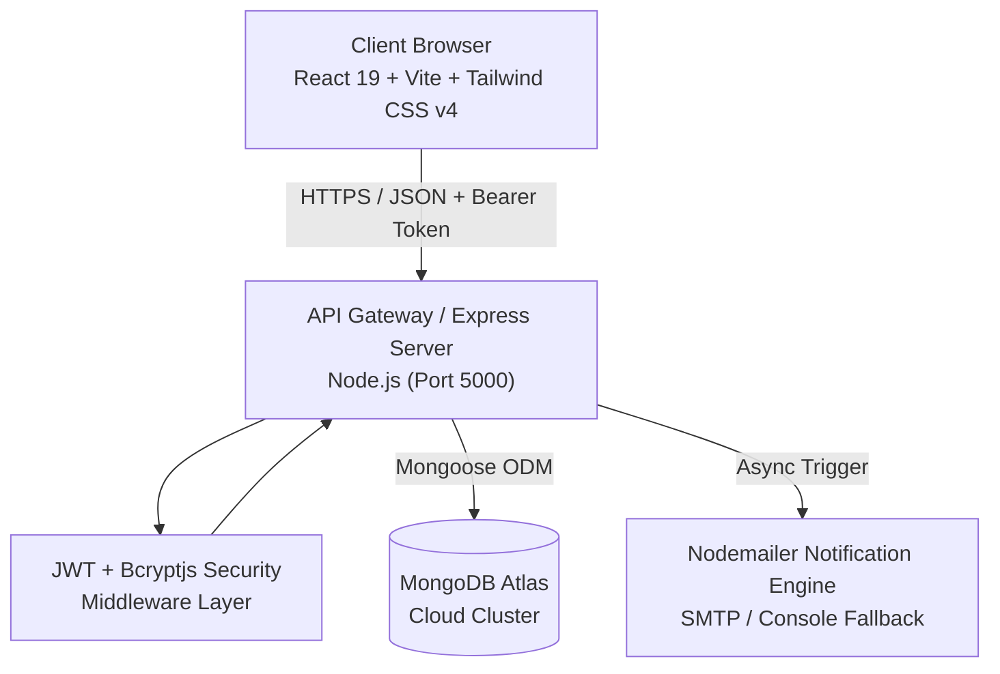
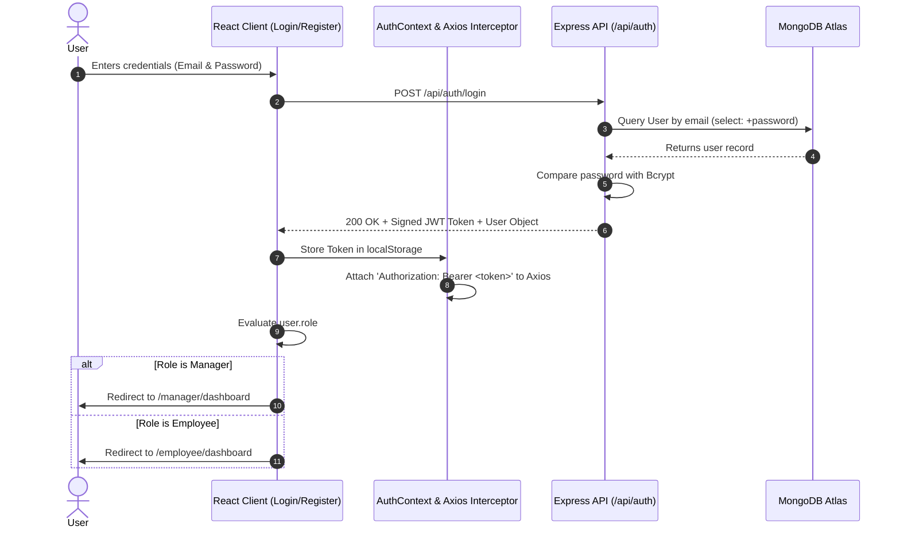
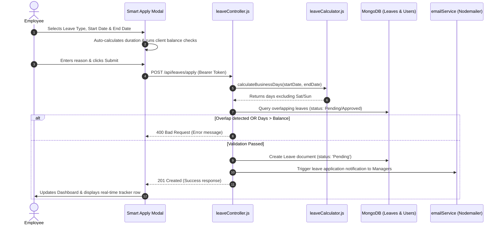
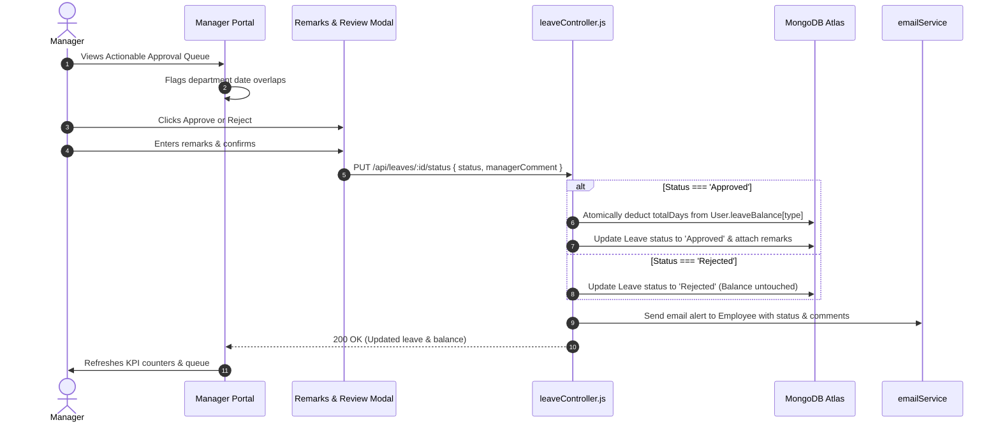
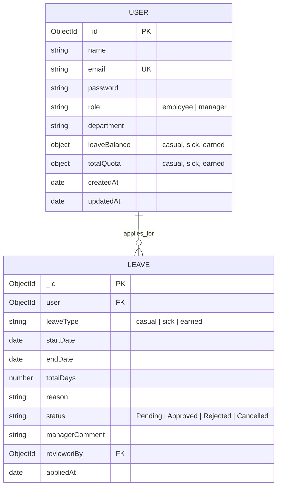

# Software Requirements Specification (SRS) & Architecture Reference
## Project: LeaveEase — Employee Leave Management System

---

## 1. Introduction

### 1.1 Purpose
This document provides a formal **Software Requirements Specification (SRS)** and technical architecture reference for **LeaveEase**, a cloud-enabled employee leave management web application built on the **MERN (MongoDB, Express.js, React, Node.js)** stack. It outlines functional and non-functional requirements, data models, end-to-end business workflows, and RESTful API specifications for university viva presentation and project report preparation.

### 1.2 Scope
LeaveEase digitizes workplace absence management through a **Dual-Portal Architecture** governed by **Role-Based Access Control (RBAC)**:
- **Employee Portal**: Allows staff to view real-time balances across categories (Casual, Sick, Earned), apply for leaves with automated business day calculations, review status badges, and cancel pending applications.
- **Manager / Admin Portal**: Equips leads and managers with an approval queue, team scheduling overlap alerts, remarks/feedback recording, and manual leave quota adjustments.

### 1.3 Key Definitions & Acronyms
- **MERN**: MongoDB, Express.js, React, Node.js
- **RBAC**: Role-Based Access Control
- **JWT**: JSON Web Token
- **Sandwich Rule / Weekend Exclusion**: Exclusion of non-working days (Saturdays & Sundays) from the total leave deduction.
- **Atomic Balance Deduction**: Immediate and consistent database update that deducts balance only upon approval, leaving it intact upon rejection.

---

## 2. Technology Stack & Architecture

### 2.1 Technology Matrix

| Layer | Technology | Version / Tool | Justification & Purpose |
| :--- | :--- | :--- | :--- |
| **Frontend Framework** | React | `^19.3.1` | Declarative component-based UI, reactive state handling |
| **Build Tool** | Vite | `^8.3.6` | Lightning-fast Hot Module Replacement (HMR) and optimized bundler |
| **Styling** | Tailwind CSS | `^4.3.5` | Utility-first, responsive, corporate-grade styling with glassmorphism |
| **Routing** | React Router DOM | `^7.x` | Client-side routing, protected routes, and role redirection |
| **HTTP Client** | Axios | `^1.7.x` | Promise-based HTTP client with request & response interceptors |
| **Icons** | Lucide React | `^0.475.x` | Clean, modern visual indicators for statuses and actions |
| **Backend Runtime** | Node.js | `v25.2.1` | High-throughput asynchronous event-driven JavaScript runtime |
| **Web Framework** | Express.js | `^4.21.2` | RESTful routing, middleware orchestration, and JSON body parsing |
| **Database** | MongoDB Atlas | Cloud M0 Cluster | Scalable NoSQL document store with JSON-native schemas |
| **ODM** | Mongoose | `^8.9.5` | Schema validation, pre-save hooks, and population queries |
| **Authentication** | JSON Web Tokens | `jsonwebtoken ^9.0.2` | Stateless signed tokens stored in `localStorage` |
| **Password Security** | Bcryptjs | `^3.0.3` | Salted one-way cryptographic password hashing |
| **Notifications** | Nodemailer | `^6.10.0` | Transactional HTML email alerts with safe console fallback |

---

## 3. End-to-End System Workflows

### 3.1 Authentication & Role-Based Routing

### 3.2 Leave Application & Validation Workflow

### 3.3 Manager Review & State Synchronization Workflow

---

## 4. Functional Requirements (FR)

### Module 1: Authentication & Access Control
- **FR-1.1 [User Registration]**: Users can register with Name, Email, Password, Department, and Role (`employee` or `manager`). Passwords must be hashed using `bcryptjs` (salt rounds = 10) before persistence.
- **FR-1.2 [User Login]**: Registered users can authenticate via email and password, receiving a cryptographically signed JWT token valid for 30 days.
- **FR-1.3 [Profile Endpoint]**: Authenticated users can retrieve their profile details and real-time leave balances via `GET /api/auth/profile`.
- **FR-1.4 [Route Guarding]**: Unauthenticated requests are redirected to `/login`. Employees attempting to access `/manager/dashboard` are redirected to `/employee/dashboard`.

### Module 2: Employee Portal Features
- **FR-2.1 [Balance Dashboard]**: Visual cards display live remaining, used, and total quota across **Casual**, **Sick**, and **Earned** leaves with percentage progress bars.
- **FR-2.2 [Smart Leave Application]**:
  - Automatically calculates total working days between start date and end date.
  - Prevents past date selection (`min = today`).
  - Blocks submission if requested days exceed available quota in the selected category.
- **FR-2.3 [Leave History Tracker]**: Searchable and filterable table (All, Pending, Approved, Rejected) showing date ranges, working days, reason, color-coded status badge, and manager comments.
- **FR-2.4 [Cancellation Rule]**: Employees can cancel/withdraw a leave application **only while its status is `Pending`**. Approved or rejected requests cannot be cancelled.
- **FR-2.5 [Quick Profile Drawer]**: An interactive profile panel in the top-right corner allows employees to view their Employee ID, Department, Employment Status, and Quota balances.

### Module 3: Manager / Admin Portal Features
- **FR-3.1 [Real-Time KPI Metrics]**: Summary cards display:
  - Pending review count (with animated alert pulse).
  - Employees on leave today.
  - Total approved leaves this cycle.
  - Total active team members.
- **FR-3.2 [Actionable Approval Queue]**: Prioritizes `Pending` requests with one-click **Approve** and **Reject** buttons.
- **FR-3.3 [Remarks Modal & Overlap Detection]**: Managers can attach comments before finalizing a decision. The modal warns if other team members in the same department are on leave during the requested dates.
- **FR-3.4 [Atomic Balance Deduction]**: Approving a request decrements the requested days from the employee's balance. Rejecting retains the balance untouched.
- **FR-3.5 [Employee Directory & Quota Management]**: Managers can view all staff balances and open the **Adjust Quota** modal to award bonus leaves or modify category quotas.

### Module 4: Standout Viva & Resume Features
- **FR-4.1 [Sandwich Rule / Weekend Exclusion]**: `calculateBusinessDays` calculates working days by skipping Saturdays (day 6) and Sundays (day 0).
- **FR-4.2 [Overlap Validation]**: The backend checks for date range overlaps with existing `Pending` or `Approved` requests for the user, preventing duplicate bookings.
- **FR-4.3 [Email Notifications]**: Nodemailer dispatches branded HTML emails to managers on submission and to employees on decision (gracefully logged in console if SMTP credentials are unset).
- **FR-4.4 [Instant Demo Switcher]**: Pre-loaded accounts (`alex@leaveease.com` and `sarah.manager@leaveease.com`) enable immediate testing without database dependencies.

---

## 5. Database Schema & Data Dictionary

### 5.1 Collection: `users`
| Field Name | Data Type | Constraints | Default | Description |
| :--- | :--- | :--- | :--- | :--- |
| `_id` | ObjectId | Primary Key, Auto | Generated | Unique user identifier |
| `name` | String | Required, Trimmed | None | Full legal name |
| `email` | String | Required, Unique, Lowercase | None | Work email address |
| `password` | String | Required, Min: 6 | None | Bcrypt-hashed password |
| `role` | String | Enum: `['employee', 'manager']` | `'employee'` | RBAC system role |
| `department` | String | Required | `'Engineering'` | Operating department |
| `leaveBalance.casual`| Number | Min: 0 | `12` | Remaining casual leaves |
| `leaveBalance.sick` | Number | Min: 0 | `10` | Remaining sick leaves |
| `leaveBalance.earned`| Number | Min: 0 | `18` | Remaining earned leaves |
| `totalQuota.casual` | Number | Integer | `12` | Total annual casual quota |
| `totalQuota.sick` | Number | Integer | `10` | Total annual sick quota |
| `totalQuota.earned` | Number | Integer | `18` | Total annual earned quota |
| `createdAt` | Date | Timestamp | `Date.now` | Account creation date |
| `updatedAt` | Date | Timestamp | `Date.now` | Last update date |

### 5.2 Collection: `leaves`
| Field Name | Data Type | Constraints | Default | Description |
| :--- | :--- | :--- | :--- | :--- |
| `_id` | ObjectId | Primary Key, Auto | Generated | Unique leave identifier |
| `user` | ObjectId | Ref: `'User'`, Required | None | Employee applying for leave |
| `leaveType` | String | Enum: `['casual', 'sick', 'earned']` | None | Category of absence |
| `startDate` | Date | Required | None | Start date of absence |
| `endDate` | Date | Required | None | End date of absence |
| `totalDays` | Number | Required, Min: 1 | None | Working days count (excluding Sat/Sun) |
| `reason` | String | Required, Trimmed | None | Detailed reason for time-off |
| `status` | String | Enum: `['Pending', 'Approved', 'Rejected', 'Cancelled']` | `'Pending'` | Lifecycle approval state |
| `managerComment` | String | Trimmed | `''` | Feedback attached by reviewer |
| `reviewedBy` | ObjectId | Ref: `'User'`, Optional | None | Manager who reviewed request |
| `appliedAt` | Date | Timestamp | `Date.now` | Application submission time |

---

## 6. REST API Endpoints Specification

### 6.1 Authentication Routes (`/api/auth`)
| Method | Endpoint | Access | Request Body | Success Response | Description |
| :--- | :--- | :--- | :--- | :--- | :--- |
| `POST` | `/api/auth/register` | Public | `{ name, email, password, role, department }` | `201 Created` + `{ token, user }` | Registers user & issues JWT |
| `POST` | `/api/auth/login` | Public | `{ email, password }` | `200 OK` + `{ token, user }` | Verifies credentials & issues JWT |
| `GET` | `/api/auth/profile` | Private | None (Bearer Token) | `200 OK` + `{ user }` | Fetches live profile & balances |

### 6.2 Leave Routes (`/api/leaves`)
| Method | Endpoint | Access | Request Body | Success Response | Description |
| :--- | :--- | :--- | :--- | :--- | :--- |
| `POST` | `/api/leaves/apply` | Private (Auth) | `{ leaveType, startDate, endDate, reason }` | `201 Created` + `{ message, leave }` | Submits leave with validation |
| `GET` | `/api/leaves/my-leaves` | Private (Auth) | None (Bearer Token) | `200 OK` + `[ leaves ]` | Fetches user's leave history |
| `PUT` | `/api/leaves/:id/cancel`| Private (Auth) | None | `200 OK` + `{ message, leave }` | Withdraws pending leave |
| `GET` | `/api/leaves/all` | Manager Only | Query: `?status=...&department=...` | `200 OK` + `[ formattedLeaves ]` | Approval queue & history |
| `PUT` | `/api/leaves/:id/status`| Manager Only | `{ status, managerComment }` | `200 OK` + `{ message, leave, balance }` | Approves/rejects & updates balance |

### 6.3 User & Quota Routes (`/api/users`)
| Method | Endpoint | Access | Request Body | Success Response | Description |
| :--- | :--- | :--- | :--- | :--- | :--- |
| `GET` | `/api/users` | Manager Only | None | `200 OK` + `[ employees ]` | Staff directory & quotas |
| `PUT` | `/api/users/:id/quota`| Manager Only | `{ casual, sick, earned }` | `200 OK` + `{ message, user }` | Adjusts employee quota |

---

## 7. Master Checklist of Implemented Modules

### Frontend Modules
- [x] **Vite + React Setup**: Monorepo subfolder layout configured with Tailwind CSS v4.
- [x] **Global Auth State (`context/AuthContext.jsx`)**: Token & user persistence in `localStorage` + Axios Bearer injection.
- [x] **Protected Route Wrapper (`components/ProtectedRoute.jsx`)**: Enforces authentication & stops unauthorized role URL access.
- [x] **Shared UI Components**:
  - [x] [Navbar.jsx](file:///d:/Study/Sem%205/MERN%20Project/LeaveEase/frontend/src/components/Navbar.jsx): Logo, role pill, profile trigger, demo switcher, and logout.
  - [x] [ProfileModal.jsx](file:///d:/Study/Sem%205/MERN%20Project/LeaveEase/frontend/src/components/ProfileModal.jsx): Top-right user details, employee ID, and quota breakdown.
  - [x] [StatusBadge.jsx](file:///d:/Study/Sem%205/MERN%20Project/LeaveEase/frontend/src/components/StatusBadge.jsx): Color-coded pills (Yellow = Pending, Green = Approved, Red = Rejected, Gray = Cancelled).
- [x] **Pages**:
  - [x] [Login.jsx](file:///d:/Study/Sem%205/MERN%20Project/LeaveEase/frontend/src/pages/Login.jsx) & [Register.jsx](file:///d:/Study/Sem%205/MERN%20Project/LeaveEase/frontend/src/pages/Register.jsx): Form validation, role selection, department picker, and instant demo buttons.
  - [x] [EmployeeDashboard.jsx](file:///d:/Study/Sem%205/MERN%20Project/LeaveEase/frontend/src/pages/EmployeeDashboard.jsx): Visual balance cards, Smart Apply Leave modal (live days calculation & overlap blocking), filterable history table, and cancel action.
  - [x] [ManagerDashboard.jsx](file:///d:/Study/Sem%205/MERN%20Project/LeaveEase/frontend/src/pages/ManagerDashboard.jsx): Summary KPI stats, Approval Queue, Remarks Modal with department coverage warning, and Employee Directory & Quota Management.

### Backend Modules
- [x] **Database Models (`models/`)**:
  - [x] [User.js](file:///d:/Study/Sem%205/MERN%20Project/LeaveEase/backend/models/User.js): Nested `leaveBalance`, `totalQuota`, email regex, and `bcryptjs` password hashing pre-save hook.
  - [x] [Leave.js](file:///d:/Study/Sem%205/MERN%20Project/LeaveEase/backend/models/Leave.js): Reference to `User`, category enum, status lifecycle, manager comment, and compound indexes.
- [x] **Middleware (`middleware/`)**:
  - [x] [authMiddleware.js](file:///d:/Study/Sem%205/MERN%20Project/LeaveEase/backend/middleware/authMiddleware.js): `protect` (verifies Bearer token) and `managerOnly` (blocks non-managers with 403 Forbidden).
- [x] **Controllers (`controllers/`)**:
  - [x] [authController.js](file:///d:/Study/Sem%205/MERN%20Project/LeaveEase/backend/controllers/authController.js): Register, Login (JWT generation), and Get Profile.
  - [x] [leaveController.js](file:///d:/Study/Sem%205/MERN%20Project/LeaveEase/backend/controllers/leaveController.js): Apply leave, Get my leaves, Cancel leave, Get all leaves, and Update leave status with atomic balance deduction.
  - [x] [userController.js](file:///d:/Study/Sem%205/MERN%20Project/LeaveEase/backend/controllers/userController.js): Directory listing and quota adjustments.
- [x] **Utilities (`utils/`)**:
  - [x] [leaveCalculator.js](file:///d:/Study/Sem%205/MERN%20Project/LeaveEase/backend/utils/leaveCalculator.js): Working days exclusion (Saturdays/Sundays) and date overlap checking.
  - [x] [emailService.js](file:///d:/Study/Sem%205/MERN%20Project/LeaveEase/backend/utils/emailService.js): Branded HTML email notifications with console fallback.
- [x] **Database Connectivity (`config/db.js`)**:
  - [x] Auto-resolving Mongoose connection to MongoDB Atlas cluster (`leaveease.bgcbkzj.mongodb.net`) with verified `{ ok: 1 }` ping.
